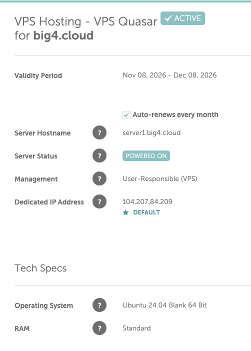

# Big4 Exocortex — Zero-Trust Public Audit (`UK AI Safety Institute Inspect`, `$0.00` & Bring Your Own Token `BYT`)

> **In one sentence:**  
> Anyone — including non-technical investors — can inspect certified scores or launch a fresh blind benchmark on a clean **Microsoft/GitHub cloud VM** using the unmodified **UK Government AI Safety Institute `Inspect`** framework, verify via `ping` and TLS socket checks that GitHub connects directly to a single commodity **Ubuntu 24.04 VPS (`104.207.84.209`)** rather than a hidden GPU cluster, and compare either Big4's **`$0.00` Orthogonal Cycle 5 Architecture** (`big4-ciclo5-free`) or **any specific commercial/open-weight model you bring via your own encrypted API key (`BYT`)**, backed by **offline `Ed25519` cryptographic verification**.

---

## 1. Why Investors Use This Audit (30-Second Overview)

Whenever an AI vendor publishes benchmarks run on private laptops or internal servers, investors rightly ask:  
*"How do I know you didn't cherry-pick easy questions, alter the grading script, hide a giant GPU cluster behind the API, or test on a different model than claimed?"*

This public repository removes vendor trust from the process through **five independent guarantees**:

1. **Neutral Microsoft / GitHub Cloud Runner:** Nothing executes on Big4 hardware. Every run boots a clean, disposable Linux VM (`ubuntu-latest`) inside Microsoft/GitHub's infrastructure and destroys it immediately afterward.
2. **Official UK Government Evaluator (`Inspect`):** Zero custom questions and zero custom grading logic live in this repo. The runner installs the unmodified [**UK AI Safety Institute `Inspect`**](https://ukgovernmentbeis.github.io/inspect_evals/) suite (`inspect-ai` + `inspect-evals`) straight from PyPI with official public benchmarks (`MMLU-Pro`, `TruthfulQA MC1`, `GPQA Diamond`, `HumanEval`).
3. **Verifiable Commodity VPS Routing (`104.207.84.209`):** Every GitHub Actions run executes [`scripts/verify_vps_target.py`](./scripts/verify_vps_target.py) before running benchmarks, asserting DNS `A`-record resolution, live TCP/TLS kernel socket peer IP (`104.207.84.209:443`), and `/health` reachability — failing closed if the endpoint ever resolves elsewhere.
4. **Blind Head-to-Head Modes (`$0.00` Free OR Bring Your Own Token `BYT`):** Inside a single reproducible run (`sample_shuffle=42`, `temperature=0`), the exact same questions go to:
   - **`$0.00` Free Audit (`free_zero_cost`)**: `$0.00` Naked Baseline (`big4-base-free-nudo`) vs. Big4 `$0.00` Cycle 5 (`big4-ciclo5-free`).
   - **Specific Model Boost via `BYT` (`byt_model_boost`)**: **Your chosen model Naked** (`big4-base-byt-nudo:<target_model>`) vs. **Your same chosen model + Big4 Cycle 5** (`big4-ciclo5-byt:<target_model>`).
   - **`$0.00` vs. Paid Specific Model (`free_big4_vs_byt_naked`)**: **Your paid model Naked** (`big4-base-byt-nudo:<target_model>`) vs. **Big4 `$0.00` Cycle 5** (`big4-ciclo5-free`).
5. **Offline Cryptographic Verification (`Ed25519`):** Five live responses are verified offline against [`public_key_ed25519.pem`](./public_key_ed25519.pem) to prove payload integrity and `Zero Data Retention (ZDR)`.

---

## 2. Dedicated Commodity VPS Proof (`104.207.84.209`) & 10-Second Ping Check

Big4's Cycle 5 orchestrator runs on a single commodity GPU-less **Namecheap VPS Quasar (`Ubuntu 24.04 Blank 64 Bit`, Standard RAM, Dedicated IP `104.207.84.209`)** — not a hidden GPU farm.



> **Routing Clarification (`server1.big4.cloud` vs. `104.207.84.209`):**  
> In the Namecheap control-panel screenshot above, `server1.big4.cloud` is the host panel's internal VM label (not a public DNS `A` record). Public HTTPS audit traffic from GitHub Actions routes via TLS 1.3 (`CN=104-207-84-209.sslip.io`) directly to the **Dedicated IP Address `104.207.84.209`**.

### Verify From Your Own Computer in 10 Seconds

#### macOS / Linux Terminal
```bash
# 1. Ping the Dedicated IPv4 shown in the VPS hosting screenshot
ping -c 4 104.207.84.209

# 2. Ping the public HTTPS hostname targeted by GitHub Actions (resolves to 104.207.84.209)
ping -c 4 104-207-84-209.sslip.io

# 3. Verify DNS + live TLS kernel peer IP (104.207.84.209:443) + Big4 gateway /health
python3 scripts/verify_vps_target.py --expected-ip 104.207.84.209
```

#### Windows PowerShell / Command Prompt
```powershell
ping -n 4 104.207.84.209
ping -n 4 104-207-84-209.sslip.io
```

#### Automated Proof Inside Every GitHub Actions Run
Look for the step **`Verify GitHub Actions -> Dedicated VPS (104.207.84.209) Ping & TLS Route`** in any workflow run log:
1. It executes `ping -c 3 -W 2 104.207.84.209` (note: Microsoft Azure VNets hosting GitHub Actions runners filter outbound raw ICMP Echo, so the step immediately continues to kernel socket verification).
2. It runs `python3 scripts/verify_vps_target.py --expected-ip 104.207.84.209 --tcp-pings 3 --out vps_target_proof.json`, proving DNS resolution (`['104.207.84.209']`), three live TLS socket handshakes with OS `getpeername() == 104.207.84.209:443`, and HTTP `200` from `/health` on that exact VPS.
3. The workflow fails closed if `BIG4_BASE_URL` ever points to any IP other than `104.207.84.209`.

---

## 3. What the 4 Official UK AISI Exams Measure

| Official Exam | Plain-Language Meaning | Why It Matters |
| :--- | :--- | :--- |
| **`MMLU-Pro`** | Multi-discipline university & professional reasoning across 10 answer choices (law, finance, engineering, medicine, physics). | Tests analytical precision when up to 9 distractors look plausible. |
| **`TruthfulQA (MC1)`** | Strict single-answer resistance to common myths, misconceptions, and hallucinations on trap questions. | Measures factual discipline over confident-sounding guesswork. |
| **`GPQA Diamond`** | PhD-level science problems (organic chemistry, quantum physics, molecular biology). | Hard reasoning filter where lightweight models normally fail sharply. |
| **`HumanEval`** | Writing real Python functions that compile and execute against hidden unit tests inside GitHub's local sandbox. | Verifies whether generated code runs and passes tests in reality. |

---

## 4. Option 1 — Read Certified Results in 30 Seconds *(No Account, No Code, 3 Clicks)*

To check the latest certified Microsoft/GitHub audit right now, **you do not need a GitHub login or technical background**:

1. **Click 1 — Open `Actions`:** At the top of this page, click the **`Actions`** tab (with the `▶` play icon next to *Pull requests*).
2. **Click 2 — Open the latest green `✅` run:** Click the top completed workflow run marked with a green checkmark **`✅`** titled **`UK AISI Inspect Public Audit ($0.00 & BYT)`**.
3. **Click 3 — Read the scorecard under `Summary`:**
   - Read the official **UK AI Safety Institute `Inspect`** table comparing Arm A vs. Arm B per benchmark and in aggregate (`Delta (pp)`).
   - Verify **`Offline Ed25519 Receipt Audit: 5/5 cryptographically verified`** and **`Dedicated VPS Hardware & Routing Proof: ... 104.207.84.209:443`** directly below the table.
   - *(Optional)* Scroll to **`Artifacts`** at the bottom *(requires GitHub sign-in)* to download **`uk-aisi-public-audit-summary`** (`public_audit_summary.json`, `ed25519_audit_report.json`, and `vps_target_proof.json`), or expand the job log to inspect every command executed by Microsoft/GitHub.

---

## 5. Option 2A — Run a Fresh `$0.00` Audit in Your Own Browser *(Zero Code, Zero Provider Keys, 5 Clicks)*

Want to execute a brand-new benchmark inside your **own private GitHub copy** — outside Big4's control — using only your web browser?

> **What you need first:**
> 1. A free `github.com` account (~60 seconds to create).
> 2. One capped Zero-Data-Retention audit token provided privately by the Big4 team:
>    - `BIG4_API_KEY` *(required — kept out of public files purely so automated internet bots cannot exhaust the server during due diligence).*  
>    - `BIG4_BASE_URL` *(optional — defaults automatically to `https://104-207-84-209.sslip.io/v1` pointing to VPS `104.207.84.209`; you can also set it explicitly in Secrets).*

### Step 1 — Sign In & Fork This Repository
1. Sign in at `github.com` and open this repository page (`big4-exocortex-public-audit`).
2. Click **`Fork`** (top-right corner) → click the green **`Create fork`** button.
3. Within 3 seconds you own a separate copy at `github.com/<your-username>/big4-exocortex-public-audit`. Nobody at Big4 can edit a single character of your copy.

### Step 2 — Save `BIG4_API_KEY` in GitHub Secrets
Inside **your forked** repository:
1. Click **`Settings`** (top navigation bar).
2. In the left menu, expand **`Secrets and variables`** → click **`Actions`**.
3. Click the green **`New repository secret`** button:
   - **`Name`**: `BIG4_API_KEY`
   - **`Secret`**: paste the audit API key provided by Big4 → click **`Add secret`**.  
   *(Optional: also add `BIG4_BASE_URL` = `https://104-207-84-209.sslip.io/v1` if desired; otherwise the workflow defaults to that exact VPS URL automatically. GitHub encrypts all secrets and automatically masks keys as `***` in every runner log.)*

### Step 3 — Click "Run workflow" in Browser
1. Click the **`Actions`** tab of your forked repository.
2. If prompted with *"Workflows aren't being run on this forked repository"*, click **`I understand my workflows, go ahead and enable them`**.
3. On the left sidebar, click **`UK AISI Inspect Public Audit ($0.00 & BYT)`**.
4. On the right, click **`Run workflow`**:
   - **`audit_mode`**: leave **`free_zero_cost`**.
   - **`target_model`**: leave blank *(uses the default `$0.00` baseline)*.
   - **`sample_limit`**: leave **`15`** *(`15` blind samples × `4` exams = `60` questions per arm, `120` evaluations total, ~8–12 minutes)*.
5. Click the green **`Run workflow`** button.

### Step 4 — Read Your Independent Scorecard
Wait **8–12 minutes** until the amber circle turns green **`✅`**, click the run, and scroll to **`Summary`** to read your independently executed table, **`5/5` Ed25519** check, and **`104.207.84.209:443` VPS Routing Proof**.

---

## 6. Option 2B — Bring Your Own Token (`BYT`) & Benchmark Any Specific Model *(Browser Only, Zero Code)*

Want to test **a specific commercial or open-weight model** (for example `Claude Sonnet`, `GPT-4o`, `Gemini 2.5`, `Gemma 4 31B`, `DeepSeek`, `Grok`) using **your own API key** (`OpenRouter`, `Anthropic`, `OpenAI`, `Google Gemini`, `Groq`, `DeepSeek`, `xAI`, `Mistral`, `Cerebras`, or `NVIDIA`)?

### How `BYT` Protects Your API Key (Zero-Trust RAM-Only Security)
- You **never** paste your API key into a public form field. You store it inside your fork's encrypted GitHub secret **`BYT_API_KEY`**.
- The runner injects **`BYT_API_KEY`** strictly over TLS in ephemeral HTTP headers/RAM per request (`X-Big4-BYT-Provider-Key`) with `Zero Data Retention (ZDR)` enforced.
- The server isolates every BYT call (`strict_byc_only=true`): **it uses your token strictly for the model you choose** and never persists your key to disk, SQLite, or logs.
- You can revoke **`BYT_API_KEY`** in your provider dashboard or delete the GitHub secret immediately after the audit.

### 4 Exact Steps to Run a Specific-Model `BYT` Benchmark

1. **Store `BYT_API_KEY` once in your fork's Secrets:**  
   In your forked repository, go to **`Settings` → `Secrets and variables` → `Actions` → `New repository secret`**:
   - **`Name`**: `BYT_API_KEY`
   - **`Secret`**: paste your API key from OpenRouter, Anthropic, OpenAI, Google Gemini, Groq, DeepSeek, xAI, Mistral, Cerebras, or NVIDIA.
   - Click **`Add secret`**. *(Make sure `BIG4_API_KEY` from Option 2A is also saved; `BIG4_BASE_URL` defaults to `https://104-207-84-209.sslip.io/v1`.)*

2. **Open `Actions` → `Run workflow`:**  
   Go to **`Actions`** → **`UK AISI Inspect Public Audit ($0.00 & BYT)`** → click **`Run workflow`**.

3. **Choose your comparison mode and exact model:**
   - **`audit_mode`**:
     - Pick **`byt_model_boost`** to test **Your Model Naked vs. Your Model + Big4 Cycle 5** *(measures whether Big4 boosts your chosen model's accuracy)*.
     - Pick **`free_big4_vs_byt_naked`** to test **Your Paid Model Naked vs. Big4 `$0.00` Cycle 5** *(measures how Big4 at `$0.00` performs against your paid commercial model)*.
   - **`target_model`**: Paste any model ID from your provider:

     | If Your `BYT_API_KEY` Is From | Example `target_model` Values You Can Paste | `byt_provider` Setting |
     | :--- | :--- | :--- |
     | **OpenRouter** *(multi-model)* | `google/gemma-4-31b-it`, `anthropic/claude-sonnet-4.6`, `openai/gpt-4o`, `deepseek/deepseek-r1` | `auto` (or `openrouter`) |
     | **Anthropic Direct** | `claude-sonnet-4-6`, `claude-opus-4-6` | `auto` (or `anthropic`) |
     | **OpenAI Direct** | `gpt-4o`, `gpt-4.1`, `o3-mini` | `auto` (or `openai`) |
     | **Google Gemini API** | `gemini-2.5-flash`, `gemini-2.5-pro` | `auto` (or `gemini`) |
     | **Groq** | `openai/gpt-oss-120b`, `llama-3.3-70b-versatile` | `auto` (or `groq`) |
     | **DeepSeek Direct** | `deepseek-chat`, `deepseek-reasoner` | set **`deepseek`** |
     | **xAI Direct** | `grok-3`, `grok-3-mini` | `auto` (or `xai`) |
     | **Mistral / Cerebras / NVIDIA** | `mistral-large-latest` / `gpt-oss-120b` / `meta/llama-3.3-70b-instruct` | `mistral` / `auto` (`cerebras` / `nvidia`) |

   - **`byt_provider`**: Keep **`auto`** for OpenRouter, Anthropic, OpenAI, Gemini, Groq, Cerebras, xAI, or NVIDIA keys; set explicitly for DeepSeek or Mistral.
   - **`sample_limit`**: Keep **`15`** (or enter `5` for a quick ~3-minute smoke check, `50` for deep statistical confidence).

4. **Click green `Run workflow` and inspect `Summary`:**  
   Within ~8–12 minutes, GitHub produces the side-by-side table showing exact per-exam accuracy, `Delta (pp)`, **`5/5` Ed25519** cryptographic receipts, and the **`104.207.84.209:443` VPS Routing Proof**.

---

## 7. Option 3 — For Your CTO or Technical Team *(Local Terminal)*

Engineering teams can verify VPS routing (`ping` + TLS socket check) and reproduce both the **`$0.00` Audit** and **`BYT` Specific-Model Audit** directly on macOS or Linux using the unmodified UK AISI `Inspect` CLI:

### A) Install, Ping Dedicated VPS & Export Credentials
```bash
git clone https://github.com/granbellllc-png/big4-exocortex-public-audit.git
cd big4-exocortex-public-audit
python3 -m pip install "inspect-ai>=0.3.285" "inspect-evals>=0.29.0" openai cryptography "datasets>=4.8.5"

export BIG4_BASE_URL="https://104-207-84-209.sslip.io/v1"
export BIG4_API_KEY="<audit key provided by Big4>"

# Prove live routing to the dedicated VPS (104.207.84.209)
ping -c 3 104.207.84.209
python3 scripts/verify_vps_target.py --expected-ip 104.207.84.209 --out vps_target_proof.json
```

### B) Run `$0.00` Mode (Naked Baseline vs. Big4 Cycle 5)
```bash
for MODEL_ID in "big4-base-free-nudo" "big4-ciclo5-free"; do
  LOG_DIR="logs/${MODEL_ID}"
  mkdir -p "${LOG_DIR}"
  FLAGS="--model openai-api/big4/${MODEL_ID} -M client_timeout=210 --limit 15 --epochs 1 --temperature 0 --max-tokens 8192 --max-connections 2 --no-fail-on-error --score-on-error --retry-on-error=2 --log-dir ${LOG_DIR}"
  inspect eval inspect_evals/mmlu_pro -T shuffle=false --sample-shuffle=42 ${FLAGS}
  inspect eval inspect_evals/truthfulqa -T target=mc1 --sample-shuffle=42 ${FLAGS}
  inspect eval inspect_evals/gpqa_diamond --sample-shuffle=42 ${FLAGS}
  inspect eval inspect_evals/humaneval -T sandbox=local --sample-shuffle=42 ${FLAGS}
done

python3 scripts/verify_ed25519_receipt.py \
  --public-key public_key_ed25519.pem \
  --live-probe-count 5 \
  --model big4-ciclo5-free \
  --out ed25519_audit_report.json

python3 scripts/render_step_summary.py \
  --arm-a-dir logs/big4-base-free-nudo \
  --arm-b-dir logs/big4-ciclo5-free \
  --ed25519 ed25519_audit_report.json \
  --vps-proof vps_target_proof.json \
  --out public_audit_summary.json
```

### C) Run `BYT` Specific-Model Mode (e.g. `google/gemma-4-31b-it` via OpenRouter or `claude-sonnet-4-6` via Anthropic)
When using the OpenAI-compatible bridge directly, pass your token either in RAM via `X-Big4-BYT-Provider-Key` (for custom clients/`verify_ed25519_receipt.py`) or using composite Bearer auth for `inspect eval`:

```bash
export TARGET_MODEL="google/gemma-4-31b-it"
export BYT_API_KEY="<your provider key>"
export BYT_PROVIDER="auto"  # or openrouter | anthropic | openai | gemini | groq | deepseek

# Ephemeral composite Bearer key unwrapped strictly in RAM by the Big4 gateway
SAVED_AUDIT_KEY="${BIG4_API_KEY}"
export BIG4_API_KEY="${SAVED_AUDIT_KEY}|byt:${BYT_PROVIDER}|${BYT_API_KEY}"

for ALIAS in "big4-base-byt-nudo" "big4-ciclo5-byt"; do
  LOG_DIR="logs/${ALIAS}"
  mkdir -p "${LOG_DIR}"
  FLAGS="--model openai-api/big4/${ALIAS}:${TARGET_MODEL} -M client_timeout=210 --limit 15 --epochs 1 --temperature 0 --max-tokens 8192 --max-connections 2 --no-fail-on-error --score-on-error --retry-on-error=2 --log-dir ${LOG_DIR}"
  inspect eval inspect_evals/mmlu_pro -T shuffle=false --sample-shuffle=42 ${FLAGS}
  inspect eval inspect_evals/truthfulqa -T target=mc1 --sample-shuffle=42 ${FLAGS}
  inspect eval inspect_evals/gpqa_diamond --sample-shuffle=42 ${FLAGS}
  inspect eval inspect_evals/humaneval -T sandbox=local --sample-shuffle=42 ${FLAGS}
done

export BIG4_API_KEY="${SAVED_AUDIT_KEY}"

python3 scripts/verify_ed25519_receipt.py \
  --public-key public_key_ed25519.pem \
  --live-probe-count 5 \
  --model "big4-ciclo5-byt:${TARGET_MODEL}" \
  --byt-api-key "${BYT_API_KEY}" \
  --byt-provider "${BYT_PROVIDER}" \
  --out ed25519_audit_report.json

python3 scripts/render_step_summary.py \
  --arm-a-dir logs/big4-base-byt-nudo \
  --arm-b-dir logs/big4-ciclo5-byt \
  --arm-a-label "Naked BYT (${TARGET_MODEL})" \
  --arm-b-label "Big4 Cycle 5 Boosted (${TARGET_MODEL})" \
  --audit-mode byt_model_boost \
  --target-model "${TARGET_MODEL}" \
  --ed25519 ed25519_audit_report.json \
  --vps-proof vps_target_proof.json \
  --out public_audit_summary.json
```

---

## 8. Unit Economics & Compliance Scope

- **Unit Economics Scope:** Calls to `big4-base-free-nudo` and `big4-ciclo5-free` log `cost_usd = 0` inside signed `Ed25519` receipts on capped audit tokens (`zdr_only = true`). Calls using `BYT_API_KEY` consume only your own provider token directly (`strict_byc_only = true`). This benchmark measures benchmark accuracy and per-call token routing; fixed orchestrator server costs and commercial SLAs for high-volume enterprise traffic are evaluated separately during commercial due diligence.
- **Cryptographic Proof vs. Organizational Compliance:** Offline `Ed25519` verification confirms response-to-payload mathematical integrity, ZDR flags, and recorded cost metadata against [`public_key_ed25519.pem`](./public_key_ed25519.pem). It does not replace formal organizational security/legal certifications such as `SOC 2`, `ISO/IEC 27001`, or dedicated enterprise GDPR agreements.

---

## 9. Repository Files & Zero-Secret Guarantee

| File | Role |
| :--- | :--- |
| [`README.md`](./README.md) | Step-by-step investor and technical auditor manual (English only). |
| [`assets/vps-quasar-104-207-84-209.png`](./assets/vps-quasar-104-207-84-209.png) | Control-panel proof of the dedicated GPU-less Namecheap VPS Quasar (`104.207.84.209`, Ubuntu 24.04). |
| [`.github/workflows/uk-aisi-public-audit.yml`](./.github/workflows/uk-aisi-public-audit.yml) | Reproducible GitHub Actions pipeline with live VPS ping/TLS verification, `$0.00` and `BYT` modes, and specific model targeting. |
| [`scripts/verify_vps_target.py`](./scripts/verify_vps_target.py) | Standalone DNS, ICMP `ping`, TLS `:443` socket peer-IP (`104.207.84.209`), and gateway `/health` verifier. |
| [`public_key_ed25519.pem`](./public_key_ed25519.pem) | Pinned `Ed25519` public key for completely offline receipt verification. |
| [`scripts/verify_ed25519_receipt.py`](./scripts/verify_ed25519_receipt.py) | Standalone Python verifier (checks response SHA-256, canonical payload SHA-256, and `Ed25519` signature, including BYT probes). |
| [`scripts/render_step_summary.py`](./scripts/render_step_summary.py) | Neutral reader of native UK AISI `.eval` archives, VPS routing proof merger, and outbound secret leak self-check. |

> **Zero Trade Secrets Exposed:** No proprietary server source code, internal weights, routing tables, or API keys are stored in this repository (only the public commodity VPS IP `104.207.84.209` and control-panel spec screenshot are published intentionally so anyone can verify hardware origin via `ping` and live TLS sockets).
